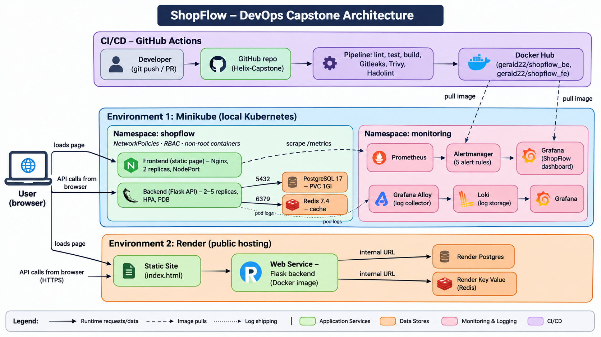

# ShopFlow DevOps Capstone

<!-- > Draft README. Replace every `TODO` with your own details as you go. Sections for later phases are stubs so the structure matches the brief. -->

## 1. Project Overview and Problem Statement

ShopFlow is a small e-commerce platform (Nginx frontend, Flask API, PostgreSQL, Redis). This project takes it through a full DevOps lifecycle: source control, containerization, CI/CD, Kubernetes, infrastructure automation, observability, security, reliability and documentation.

- **Problem:** ShopFlow was handed over as a working e-commerce application (Nginx frontend, Flask API, PostgreSQL, Redis) with only a basic Docker Compose setup. It had no pipeline, so nothing was tested, scanned or built automatically; it ran only on a single machine with hard-coded settings and `latest` image tags; and it had no orchestration, no metrics or alerts, no centralized logs and no security controls, so failures were invisible and releases were not repeatable. This project takes it through a full DevOps lifecycle: a Git workflow, secure versioned container images, a CI pipeline with security gates, Kubernetes with probes, autoscaling and network policies, Prometheus and Grafana monitoring with alerts, Loki logging, and a public deployment on Render.
- **Track:** A (Minikube only). The AWS EC2 track (Terraform and Ansible) was not attempted; a public deployment on Render was added instead.
- **Team:** Gerald
- **Repository:** https://github.com/Gerald-Izuchukwu/Helix-Capstone.git

## 2. Architecture



**Request flow**
 
1. The user's browser loads the static frontend page, served by Nginx in Minikube or by a Render static site.
2. The page's JavaScript calls the Flask API directly from the browser (`/api/products`, `/api/orders`). In Minikube the API is reached through a port-forward on port 5000; on Render it is called over HTTPS, and CORS is enabled on the API.
3. The Flask API reads and writes PostgreSQL, which holds products and orders. It also connects to Redis, the cache layer, whose availability is checked by the `/ready` endpoint together with the database.
**Delivery and operations**
 
- GitHub Actions lints, tests, builds and scans each change, then pushes the images to Docker Hub. Minikube and Render both pull from there.
- In Minikube, Prometheus scrapes the API's `/metrics` endpoint, Alertmanager receives the alert rules, and Grafana shows the dashboard. Grafana Alloy ships pod logs to Loki, which Grafana queries.
- Inside the `shopflow` namespace, default-deny NetworkPolicies allow only the required paths, and containers run as non-root with no API credentials.

## 3. Technology Choices and Justification
 
| Area | Tool | Why |
| --- | --- | --- |
| Source control | Git + GitHub | Required by the brief, and gives one place for branching, PRs, review and CI. |
| Containers | Docker, Docker Compose | The same image runs on a laptop, Minikube and Render, and Compose starts the whole stack with one command. |
| CI/CD | GitHub Actions | Lives next to the code with no extra server, and every gate fails the build. |
| Orchestration | Kubernetes (Minikube) | Required by the brief; gives self-healing, autoscaling, rolling updates and network policies locally for free. |
| Package management | Helm | Installs the monitoring and logging stacks as versioned releases with values files kept in Git. |
| Monitoring | Prometheus, Grafana (kube-prometheus-stack) | The standard Kubernetes metrics stack, with scrape targets, alerts and dashboards declared as YAML in Git. |
| Logging | Loki + Grafana Alloy | Loki is light enough for one node and is searched from the same Grafana as the metrics; Alloy is the current recommended collector. |
| Security | Gitleaks, Trivy, Hadolint | They run in CI and fail the build before anything is released. |
| Kubernetes hardening | securityContext, RBAC, NetworkPolicies | Non-root containers, dropped capabilities, no API tokens and default-deny network rules give least privilege. |
| Public hosting | Render | Runs containers, Postgres and Redis-compatible storage with no server to manage, at no cost. |
| IaC / config management | Not used | Terraform and Ansible belong to the AWS track, and this submission follows Track A. |
| GitOps | Not implemented | Deployments use `kubectl` and Helm; ArgoCD is the next step if time allows. |

## 4. Local Deployment (Docker Compose), Phase 1

```bash
git clone https://github.com/Gerald-Izuchukwu/Helix-Capstone.git
cd Helix-Capstone
git checkout -b <your-project-branch>
docker compose up --build
docker compose ps
curl http://localhost:5000/health
curl http://localhost:5000/metrics
```

**What I inspected before running:** 
- Backend, 
- Frontend, 
- Dockerfiles, 
- Compose file

**Verification:** 
- Frontend URL: Verified, 
- `/health` response: Verified, 
- `/metrics` sample: Verified

### Problems encountered and how I fixed them

| # | Problem (exact error) | Cause | Fix |
| --- | --- | --- | --- |
| 1 | `mkdir() "/var/cache/nginx/client_temp" failed (30: Read-only file system)`; frontend pod in `CrashLoopBackOff` | The Kubernetes manifest set a read-only root filesystem, but the stock Nginx image must write cache and PID files, and as a non-root user it also cannot bind port 80 | Switched the frontend image to `nginxinc/nginx-unprivileged` listening on port 8080, mounted `emptyDir` volumes for the writable paths, and pointed the Service and probes at 8080 |
| 2 | Trivy `DS-0002 (HIGH): Specify at least 1 USER command in Dockerfile with non-root user as argument` | The frontend Dockerfile had no `USER` instruction, so the scanner could not confirm a non-root user | Added an explicit numeric `USER 101` |
| 3 | `ERROR: failed to build: invalid tag "gerald22/shopflow_be:<sha>:<sha>": invalid reference format` | The pipeline appended the commit SHA to an image name that already contained it, producing two colons | Kept the image name and tag in separate variables so the tag is added only once |
| 4 | `hadolint: ./backend/Dockerfile: does not exist` | The repo was reorganized into `application/backend` and `application/frontend`, but the workflow still used the old path | Updated the Dockerfile and build context paths in the workflow |
| 5 | Prometheus target for the backend returned 404 on `/metrics` | The supplied image did not expose a metrics endpoint | Added `prometheus-flask-exporter` and released the backend as a new image tag |

## 5. Git and GitHub Workflow, Phase 2

**Branching strategy** (required in README):

- `main`: always deployable, protected, changes only via pull request
- `feature branches`: one branch per significant change

**Commit message convention:** `Type: short summary`

**Pull requests:** [PR 1](https://github.com/Gerald-Izuchukwu/Helix-Capstone/pull/1), [PR 2](https://github.com/Gerald-Izuchukwu/Helix-Capstone/pull/2)

<!-- **Merge conflict exercise:** AI-TODO (which file, how it was created, how it was resolved)

**Branch protection:** TODO (rules enabled, or note if the plan did not permit it)

**Evidence:** repository URL TODO, commit history TODO, PR screenshots in `docs/screenshots/phase2/` -->

## 6. Docker Engineering, Phase 3

**Improvements made to the supplied containerization:**

| Area | Before | After | Reason |
| --- | --- | --- | --- |
| Image tags | `latest` | versioned tags (`1.0`, `1.1`, `1.2`) plus the commit SHA from CI | Pinned tags make deployments reproducible and traceable to a commit, and let Kubernetes roll back to an exact earlier version. `latest` can change underneath a running system. |
| User | root | non-root (backend `appuser`, uid 10001; frontend uid 101) | A compromised process running as root can do far more damage and is closer to escaping the container. A numeric non-root user also lets Kubernetes enforce `runAsNonRoot`. |
| Config | hard-coded | environment variables (`DATABASE_URL`, `REDIS_URL`, `PORT`) | One image runs unchanged in every environment (Compose, Minikube, Render). Credentials stay out of the image and out of Git and are injected at runtime from a ConfigMap, Secret or the hosting dashboard. |
| Health checks | none | added (curl against `/health`) | Lets Docker and Compose know when the service is actually serving, so dependent containers start in the right order and a hung container is detected. Kubernetes uses its own HTTP probes against the same endpoint. |
| Image size |  | 113 MB | A slim base image and no dev or build files keep pulls fast and leave fewer packages to patch. |
| `.dockerignore` | none | added | Keeps `venv/`, `.git`, caches and local env files out of the build context, which gives smaller images, faster builds, and no risk of copying secrets into a layer. |

<!-- **Image list:** TODO (`docker images` output)

**Compose test:** TODO (commands and results) -->

## 7. CI/CD, Phase 4

**Pipeline stages:** checkout → install deps → lint → test → build images → dependency/source scan → image scan → (publish)

| Stage | Tool | 
| --- | --- | 
| Lint | Flake8/Hadolint |
| Tests | pytest | 
| Dependency scan | Trivy | 
| Secret scan | Trivy | 
| Image scan | Trivy | 
| Publish (extension) | Docker Hub / ECR | 

**Proof that gates fail:** [Failed Run](https://github.com/Gerald-Izuchukwu/Helix-Capstone/actions/runs/39109006042/job/117620951307)

**Workflow file:** `.github/workflows/ci.yaml`

## 8. Kubernetes Architecture, Phase 5

ShopFlow runs on Minikube in a dedicated `shopflow` namespace. Manifests live in `k8s/` and are numbered so they apply in dependency order.
 
```bash
minikube start --cpus=4 --memory=6144 --driver=docker
minikube addons enable metrics-server
kubectl apply -f k8s/
kubectl get all,pvc,configmap,secret,hpa,pdb -n shopflow
minikube service frontend -n shopflow --url
```
 
### Manifests
 
| File | Resources | Notes |
| --- | --- | --- |
| `00-namespace.yaml` | Namespace `shopflow` | |
| `01-configmap.yaml` | ConfigMap `shopflow-config` | Non-sensitive settings only (hosts, ports, DB name, Redis URL) |
| `examples/02-secret.example.yaml` | Secret template | Placeholders only; the real Secret is created in the cluster |
| `03-postgres-pvc.yaml` | PVC `postgres-pvc` (1Gi) | Dynamically provisioned by Minikube's `standard` StorageClass |
| `04-postgres.yaml` | Deployment + Service `postgres` | `postgres:17-alpine`, `Recreate` strategy, probes using `pg_isready` |
| `05-redis.yaml` | Deployment + Service `redis` | `redis:7.4-alpine`, no volume (cache only) |
| `06-backend.yaml` | Deployment + Service `backend` | 2 replicas, image `gerald22/shopflow_be:1.1`, probes on `/health` |
| `07-frontend.yaml` | Deployment + Service `frontend` | 2 replicas, image `gerald22/shopflow_fe:1.0`, NodePort |
| `08-backend-hpa.yaml` | HorizontalPodAutoscaler | 2 to 5 replicas at 70% CPU |
| `09-backend-pdb.yaml` | PodDisruptionBudget | `minAvailable: 1` |
 
### Design decisions
 
- **Image workflow:** images are pulled from public Docker Hub repositories (`gerald22/shopflow_be`, `gerald22/shopflow_fe`) published by the Phase 4 pipeline, so nothing is built inside Minikube.
- **Only the frontend is exposed.** Postgres, Redis and the backend are `ClusterIP` Services reachable only inside the cluster; the frontend is `NodePort`.
- **Postgres has persistent storage; Redis does not.** Postgres is the system of record, so it uses a PVC. Redis is a disposable cache and rebuilds itself.
- **Postgres uses the `Recreate` strategy** so two pods never contend for the same `ReadWriteOnce` volume. `PGDATA` points to a subdirectory to avoid the `lost+found` startup error.
- **Pinned image tags** (no `latest`) for Postgres and Redis in the cluster.
- **Probes and resources:** every workload has readiness and liveness probes and CPU/memory requests and limits. The HPA depends on the backend CPU request.
- **Labels:** each workload carries an `app` label that its Service and PDB select on.
### Secrets handling
 
No real credentials are committed to Git. The Secret is created directly in the cluster:
 
```bash
kubectl create secret generic shopflow-secret \
  --namespace shopflow \
  --from-literal=POSTGRES_USER=<user> \
  --from-literal=POSTGRES_PASSWORD='<password>'
```
 
The backend's `DATABASE_URL` is assembled at runtime from the Secret values using Kubernetes variable expansion, so the password never appears in the ConfigMap. A `secret.example.yaml` with placeholders documents the expected keys, and real secret files are git-ignored.
 
### Autoscaling and disruption budget evidence
 
- A load generator against `/health` pushed backend CPU to 170% of the request, and the HPA scaled the backend from 2 to 4 and then 5 replicas (the configured maximum) within about 20 seconds of crossing the threshold. CPU later reached 381% at the maximum.
- `kubectl describe pdb backend-pdb` showed `Min available: 1` with 4 allowed disruptions while 5 replicas were running. With the normal 2 replicas, 1 disruption is allowed, so at least one backend pod always stays up during a node drain.
- Screenshots: `docs/screenshots/phase5/`
### Problems encountered and fixes
 
| Problem | Cause | Fix |
| --- | --- | --- |
| Backend in `CrashLoopBackOff` with `password authentication failed` | The backend reads one `DATABASE_URL` that still held the Docker Compose credentials, while Postgres was initialized from the Kubernetes Secret | Removed `DATABASE_URL` from the ConfigMap and built it from the Secret values in the Deployment |
| Credentials in plaintext in the ConfigMap | `DATABASE_URL` contained the password | Same fix; recorded as a security finding for Phase 11 |
| Redis would have failed to connect | `REDIS_URL` used port 6378, but Redis listens on 6379 | Corrected the port in the ConfigMap |
| Empty product list in the UI | The database was recreated and nothing seeds products automatically | Expected behavior; products are added through the API |
## 9. AWS EC2 Deployment (Terraform + Ansible), Phases 6 to 8
 
Not applicable: this submission follows Track A (Minikube only).
 
## 10. Monitoring and Logging, Phases 9 and 10
 
Everything lives in `monitoring/` and is installed into the `monitoring` namespace.
 
### Files
 
| File | Purpose |
| --- | --- |
| `values.yaml` | Helm values for kube-prometheus-stack (Prometheus, Grafana, Alertmanager, kube-state-metrics, node-exporter) |
| `backend-servicemonitor.yaml` | Tells Prometheus to scrape the backend's `/metrics` every 15 s |
| `shopflow-dashboard-cm.yaml` | Grafana dashboard "ShopFlow Overview", loaded automatically by Grafana's sidecar |
| `shopflow-alerts.yaml` | PrometheusRule with five alerts |
| `loki-values.yaml` | Helm values for Loki (single binary, filesystem storage, 72 h retention) |
| `alloy-values.yaml` | Helm values and pipeline for Grafana Alloy (log collection) |
| `loki-datasource.yaml` | Registers Loki as a Grafana data source |
 
### Install
 
```bash
helm repo add prometheus-community https://prometheus-community.github.io/helm-charts
helm repo add grafana https://grafana.github.io/helm-charts
helm repo update
 
helm install monitoring prometheus-community/kube-prometheus-stack \
  -n monitoring --create-namespace -f monitoring/values.yaml \
  --set grafana.adminPassword='<set-at-install-time>'
kubectl apply -f monitoring/backend-servicemonitor.yaml
kubectl apply -f monitoring/shopflow-dashboard-cm.yaml
kubectl apply -f monitoring/shopflow-alerts.yaml
 
helm install loki grafana/loki -n monitoring -f monitoring/loki-values.yaml
helm install alloy grafana/alloy -n monitoring -f monitoring/alloy-values.yaml
kubectl apply -f monitoring/loki-datasource.yaml
 
kubectl port-forward svc/monitoring-grafana 3000:80 -n monitoring
kubectl port-forward svc/monitoring-kube-prometheus-prometheus 9090:9090 -n monitoring
```
 
The Grafana admin password is supplied on the command line at install time and is not stored in Git. Prometheus is configured to discover ServiceMonitors and rules in any namespace, and keeps 6 hours of data to limit memory use on Minikube.
 
### Application metrics
 
The supplied backend image did not expose `/metrics`, so the backend was instrumented with `prometheus-flask-exporter` and released as image `1.2`. It records request counts and request-duration histograms labelled by method, path and status. A ServiceMonitor selects the backend Service (which has a named `http` port) and scrapes `/metrics`.
 
### Dashboard
 
The "ShopFlow Overview" dashboard is stored as a ConfigMap in Git and has eight panels:
 
| Panel | What it shows | Source |
| --- | --- | --- |
| Request rate | User requests per second by method | Backend metrics |
| HTTP 5xx error ratio | Share of user requests returning 5xx | Backend metrics |
| Request latency p95 / p50 | Latency percentiles from the duration histogram | Backend metrics |
| Pod restarts | Restart count per pod | kube-state-metrics |
| CPU usage by pod | CPU cores per pod | cAdvisor |
| Memory usage by pod | Working-set memory per pod | cAdvisor |
| Replicas available vs desired | Workload health per deployment | kube-state-metrics |
| Backend pods up | Whether each backend pod is scrapeable | Prometheus `up` |
 
Request panels exclude `/health`, `/ready` and `/metrics` so Kubernetes probes and Prometheus scrapes do not hide real user traffic.
 
### Alerts
 
| Alert | Condition | Severity |
| --- | --- | --- |
| `BackendHighErrorRate` | 5xx responses above 5% of user requests for 5 min | critical |
| `BackendHighLatency` | p95 latency above 1 s for 5 min | warning |
| `PodRestartingFrequently` | More than 2 container restarts in 15 min | warning |
| `BackendDown` | No available backend replicas for 1 min | critical |
| `DatabaseUnavailable` | No available Postgres replica for 1 min | critical |
 
Each alert carries a description that says what to check first. Alerts were tested by scaling Postgres to zero and confirming `DatabaseUnavailable` moved from pending to firing (evidence in `docs/screenshots/phase9/`). Alertmanager receives the alerts, but no external notification receiver is configured.
 
### Logging (Phase 10)
 
Grafana Alloy runs as a single Deployment, discovers pods through the Kubernetes API, keeps only the `shopflow` namespace, labels each stream with `namespace`, `pod`, `container` and `app`, and pushes the logs to Loki. Loki runs in single-binary mode with 5 Gi of persistent storage and 72 hours of retention. Reading logs through the API (not from node files) suits a single-node Minikube cluster; a multi-node cluster would use a DaemonSet instead.
 
Useful queries in Grafana Explore (data source Loki):
 
```
{namespace="shopflow", app="backend"}
{namespace="shopflow", app="backend"} |~ "(?i)error|exception|OperationalError"
sum(count_over_time({namespace="shopflow", app="backend"} |~ "(?i)error|exception" [1m]))
```
 
<!-- ### Incident correlation example
 
| Time | Event | Evidence |
| --- | --- | --- |
| TODO | Postgres scaled to 0 (simulated outage) | terminal |
| TODO | First 500 responses; backend logs show database connection errors | Loki query |
| TODO | `DatabaseUnavailable` firing | Prometheus alerts page |
| TODO | Postgres restored, errors stop | Loki error-rate graph |
 
Fill the times in from your own run. The log errors, the alert start times and the dashboard error panels all line up on the same window. -->
 
### Problems encountered and fixes
 
| Problem | Cause | Fix |
| --- | --- | --- |
| Prometheus target for the backend returned 404 | Supplied image had no `/metrics` route | Added `prometheus-flask-exporter`, released image 1.2 |
| New backend pod refused connections during rollout | Rolling update in progress with a bad first release; old pods kept serving | Rebuilt the Deployment; documented `kubectl rollout undo` as the rollback |
| CPU and memory panels showed no data | cAdvisor series on this cluster have a `pod` label but no `container` label, so a `container!=""` filter removed everything | Changed panel queries to filter on `pod!=""` |
| Error-ratio panel showed "No data" while healthy | Numerator was an empty series when no 5xx occurred | Wrapped the numerator in `or vector(0)` |
| Loki pod showed 1/2 ready at first | Slow start of the Loki container | Waited; both containers became ready, no config change |
| Alloy pod stuck in ContainerCreating | Slow image pull | Waited for the pull (or pre-loaded the image into Minikube) |
 
### Screenshots
 
Saved in `docs/screenshots/phase9/` and `docs/screenshots/phase10/`: monitoring pods, Prometheus targets with the backend UP, the full dashboard under load, the alerts page (inactive and firing), Loki and Alloy pods, Explore showing backend logs, and the error-rate graph for the incident window.

<!-- ## 11. Security Controls and Findings, Phase 11

TODO (at least two findings: what, risk, how addressed)

## 12. GitOps Workflow (ArgoCD), Phase 12

TODO

## 13. Deployment Strategy and Rollback Procedure, Phase 13

TODO

## 14. SLIs, SLOs and Error Budget, Phase 14

TODO

## 15. Incident Response / Runbook

TODO

## 16. Failure-Testing Evidence, Phase 15

TODO (symptom → detection → investigation → root cause → mitigation → recovery → prevention, per scenario)

## 17. Cost Analysis, Phase 16

TODO

## 18. Lessons Learned

TODO -->
